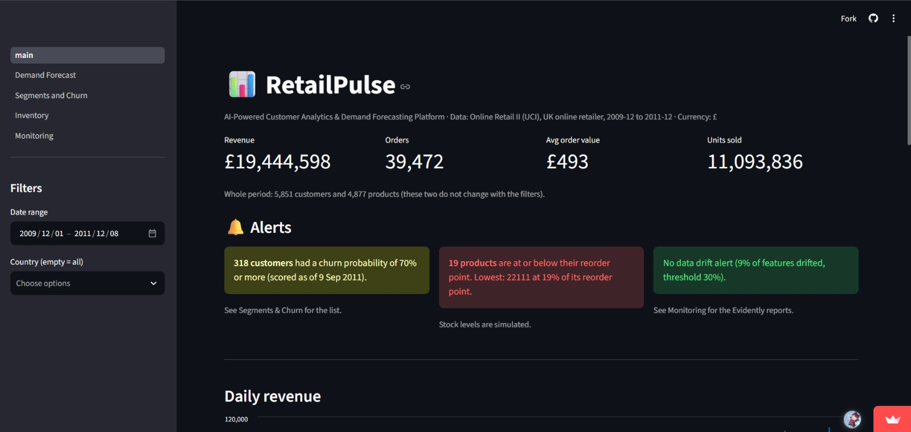
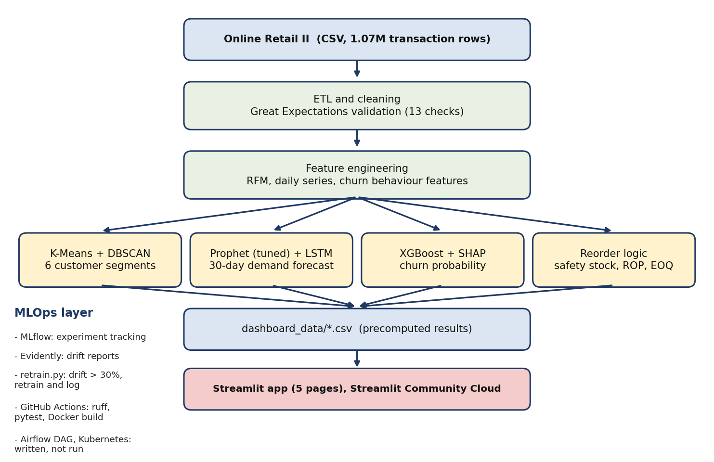

# RetailPulse: AI-Powered Customer Analytics & Demand Forecasting Platform


**Retail shops lose money when popular items run out and when slow items pile up. RetailPulse uses two years of real transactions to forecast daily revenue, group customers into segments, flag customers likely to leave, and suggest reorder quantities. It is meant for inventory planners, marketing teams and managers, and the results are in a live dashboard.**

- **Live demo:** https://retailpulse-kritikamohan.streamlit.app/



## Features

| Page | What it does |
|---|---|
| Overview | KPIs, alerts (at-risk customers, reorder, drift), daily revenue, top countries and products, with date and country filters |
| Demand Forecast | 30-day revenue forecast, model comparison, promo-lift what-if slider |
| Segments & Churn | 6 RFM customer segments; churn risk list with SHAP explanations |
| Inventory | Reorder points, safety stock, EOQ and a policy simulation |
| Monitoring | Evidently drift reports and a drift simulator |

**I am proudest of the drift loop: when I shift customer behaviour on purpose, the dashboard raises an alert and my script retrains and logs the model.**

## Architecture



The dashboard only reads small precomputed files from `dashboard_data/`, so it opens fast and needs no secrets or paid services.

## Data

Online Retail II (UCI): a UK online retailer, December 2009 to December 2011, 1,067,371 transaction rows.

| Cleaning step | Rows removed |
|---|---|
| Exact duplicates | 34,335 |
| Cancelled invoices | 19,104 |
| Price <= 0 (includes stock adjustments) | 6,019 |
| Non-product stock codes | 4,699 |
| **Rows kept** | **1,003,214** of 1,067,371 |

About 23% of rows have no customer ID. They are kept for demand forecasting and excluded from customer models (5,852 customers).

**I removed rows that are not real product sales: cancellations, stock adjustments with a price of zero, and fee codes such as postage. I kept rows without a customer ID for forecasting, because total demand doesn’t need a customer, and left them out of the customer models. I counted the rows removed by each rule so every cleaning decision can be checked.**

Stock levels and supplier lead times on the Inventory page are **simulated**, because the dataset has no inventory records. The dataset also has no cost data, so only revenue is analyzed.

## Results

**Demand forecasting** (30-day test window, 9 Nov to 8 Dec 2011):

| Model | MAPE (trading days) | WAPE |
|---|---|---|
| Seasonal naive | 29.37% | 25.53% |
| Prophet baseline | 20.83% | 26.06% |
| LSTM | 33.32% | 36.31% |
| Ensemble (50/50) | 21.40% | 27.48% |
| Prophet + Saturday rule | 20.83% | 19.80% |
| **Prophet tuned + Saturday rule (final)** | **19.34%** | **19.49%** |

Error by forecast horizon (first N days of the same forecast):

| Horizon | MAPE | WAPE |
|---|---|---|
| 7 days | 14.30% | 18.76% |
| 14 days | 14.21% | 16.76% |
| 21 days | 18.91% | 18.80% |
| 30 days | 19.34% | 19.49% |

MAPE is computed on trading days only, because the shop is closed on Saturdays and the actual value is zero. On three earlier 30-day validation windows the daily MAPE averages about 32%, so the test window is the easier one. Weekly (7-day total) MAPE is 9.9% on the test window and 17.5% on average across the validation windows (4 weeks each, a rough indication).

**Churn prediction** (no purchase in the 90 days after the cutoff date):

| Evaluation | AUC | Precision@top 20% |
|---|---|---|
| Random split, test set (cutoff 2011-09-09) | 0.714 | 0.658 |
| Cross-validation (training data) | 0.780 | n/a |
| Out-of-time: trained on 12 earlier cutoffs, tested on 2011-09-09 | 0.768 | 0.686 |

The base churn rate is 38.5%, so precision@top 20% of 0.686 is about 1.8 times better than a random pick. The brief's targets were AUC 0.88 and precision 0.75.

**Customer segments:** 5,852 customers in 6 segments. The 472 Champions (8.1%) account for 54.4% of the revenue from identified customers.

**Inventory (simulated stock):** in a 30-day simulation on real demand, the optimized reorder policy cut unmet demand by 46% to 78% across three random seeds, while average inventory roughly doubled.

**Drift monitoring:** 29% of features flagged on real data (no retraining); 71% on simulated drift (retraining triggered).

**My results are below the brief’s targets: forecast MAPE is 19.34% against 12%, and churn AUC is 0.71 to 0.77 against 0.88. Daily revenue swings a lot because of large wholesale orders and the Saturday closures, and the data covers only two years, which probably limits both models. I reported the numbers as measured, including validation windows where the error was higher.**

## Tech stack

Python 3.11, pandas, scikit-learn, Prophet, PyTorch Lightning, XGBoost, SHAP, Optuna, MLflow, Evidently, Great Expectations, Streamlit, Docker, GitHub Actions, pytest, ruff.

## Project structure

```
app/                 Streamlit app (main.py and pages/)
dashboard_data/      small result files the app reads
notebooks/           01_eda, 02_cleaning_features, 03_segmentation,
                     04_forecasting, 05_churn, 06_inventory
src/                 metrics.py, retrain.py, make_dashboard_data.py
dags/                Airflow DAG for scheduled retraining
tests/               pytest checks for metrics and saved results
k8s/                 Kubernetes manifests (written, not deployed)
reports/             figures and drift reports
Dockerfile           multi-stage image for the app
requirements.txt     minimal packages for the Streamlit app (used for deployment)
requirements-dev.txt full environment used for training and notebooks
```

## Run locally

```bash
python -m venv venv
venv\Scripts\activate          # Windows
source venv/bin/activate       # Mac / Linux
pip install -r requirements-dev.txt
streamlit run app/main.py
```

To rebuild the results, download [Online Retail II](https://www.kaggle.com/datasets/mashlyn/online-retail-ii-uci) as `data/raw/online_retail_II.csv`, run the notebooks in order (01 to 06), then:

```bash
python src/make_dashboard_data.py
pytest -q
python src/retrain.py
```

## Limitations

- Stock levels and lead times are simulated, because the data has no inventory records.
- Forecast MAPE (19.34% on test, about 32% on earlier windows) and churn AUC (0.714 random split, 0.768 out-of-time) are below the brief's targets.
- Churn was evaluated at a single future cutoff date, in the busy autumn period.
- The what-if slider scales the forecast and is a scenario, not a trained promotion model.
- The data has no cost information, so only revenue is analyzed.

## Author

Kritika Mohan, October 2026
